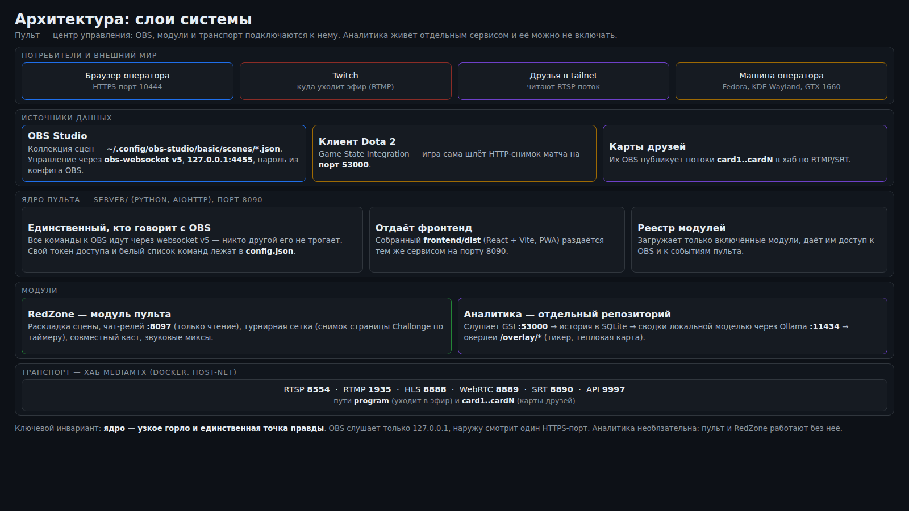
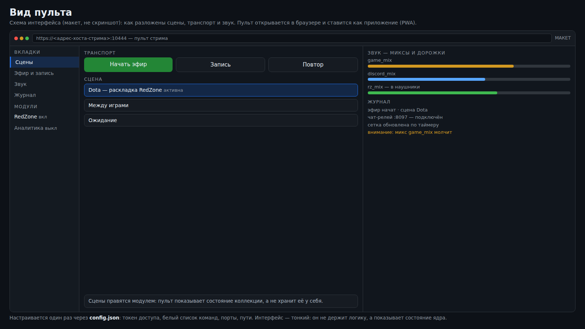
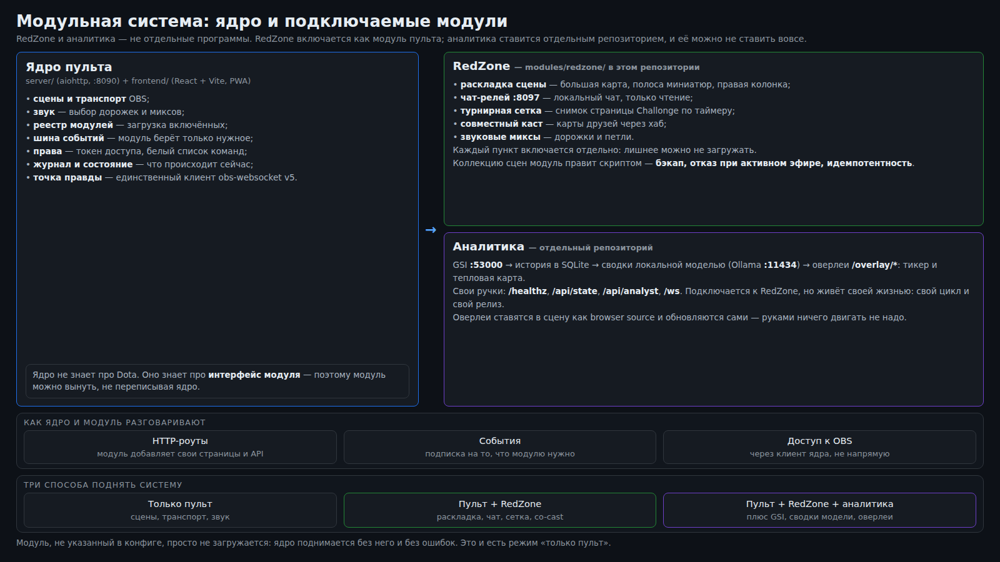

# Пульт стрима + RedZone

Планшет на держателе вместо цифрового блока: сцены, эфир, запись, повтор и звук — с телефона
или планшета в домашней сети или в tailnet. Плюс модуль **RedZone**: мультитрансляция нескольких
карт Dota 2, локальный чат, турнирная сетка, совместный каст и раздельный звук.

Проект — это сервис на компьютере, где идёт эфир, и веб-страница, которую вы открываете на планшете.
Никаких облаков и чужих аккаунтов: всё живёт на вашей машине.



## Состав

- **Ядро пульта** — Python-сервис (`server/`, aiohttp, порт 8090). Единственный, кто говорит с
  OBS через **obs-websocket v5** (`127.0.0.1:4455`). Собранный фронт (React + Vite, PWA) отдаётся
  тем же сервисом из `frontend/dist`.
- **Модуль RedZone** (`modules/redzone/`) — раскладка сцены «одна большая карта + полоса миниатюр»,
  локальный чат-релей (порт 8097, только чтение), турнирная сетка, совместный каст и звуковые миксы.
  Подключается как модуль пульта, а не как отдельная программа.
- **Хаб MediaMTX** (`deploy/mediamtx/`) — приёмный медиасервер: друзья отдают свои окна, вы читаете
  их локально; отсюда же друзья-соведущие смотрят готовый эфир с задержкой меньше секунды.
- **Модуль аналитики** — отдельный проект (ссылка в [`docs/MODULES.md`](docs/MODULES.md)): принимает
  Game State Integration от Dota 2 и рисует оверлеи. Пульт и RedZone работают без него.

## Быстрый старт (5 шагов)

1. **Включите obs-websocket v5** в OBS: `Инструменты → Настройки WebSocket-сервера`, порт `4455`,
   пароль сгенерируйте и сохраните. OBS — источник правды о состоянии; без него пульт покажет «OBS офлайн».
2. **Поставьте зависимости** (Python 3.12+, Node 20+): `tools/install.sh`.
3. **Соберите фронт**: `npm --prefix frontend run build`.
4. **Поднимите сервис**: `tools/panel.sh up`; проверка — `tools/panel.sh status` и открытая страница
   `http://127.0.0.1:8090`.
5. **Откройте пульт на планшете** по tailnet-адресу (HTTPS) и введите токен из `config.json`; установите
   на домашний экран. Подробно — [`docs/INSTALL.md`](docs/INSTALL.md).



## Два варианта установки

**Только пульт** — сцены, транспорт и звук с планшета. Нужны OBS с obs-websocket v5, Python и
один раз собранный фронт. Хаб, RedZone и аналитика не нужны.

**Пульт + RedZone** — то же плюс модуль RedZone: раскладка карт в OBS, хаб MediaMTX, чат-релей,
турнирная сетка, совместный каст и режимы звука «Стрим / Обычный». Нужен ещё Docker (для хаба) и
PipeWire (для раздельного звука).

Оба пути по шагам, с проверкой после каждого шага, — в [`docs/INSTALL.md`](docs/INSTALL.md).

## Что умеет пульт

- **Сцены** — переключение текущей сцены; активная меняется только по подтверждению от OBS.
- **Эфир** — раздельные кнопки старта и стопа с удержанием (hold-to-confirm ~1.5 с).
- **Запись** — одна кнопка-переключатель; сторону (старт/стоп) решает OBS по своему состоянию.
- **Повтор** — сохранение повтора, если буфер повтора включён в OBS.
- **Звук** — mute и громкость отдельно для микрофона и системного звука, плюс живые уровни (VU).
- **Режим звука** — «Стрим» (миксы и петли) / «Обычный» (напрямую в наушники) и выбор устройства вывода.
- **Паника** — одним действием: сцена «Чёрный экран» + mute микрофона и системы; работает даже при
  потере связи с OBS, не дожидаясь подтверждений.

Состояние синхронизируется по событиям OBS и периодическим ресинком; при обрыве связи управляющие
кнопки становятся недоступны, а разрушительные действия сервис отклоняет, пока состояние не
подтвердится заново. Оптимистичного UI нет: интерфейс меняется после ответа OBS, а не по тапу.

## Что делает RedZone

Раскладка «как NFL RedZone»: одна большая карта в фокусе, полоса миниатюр остальных, справа колонка
чата; фокус переключается сценой. Карты — это либо локальный клиент игры (захват игры), либо поток
друга из хаба. Плюс:

- **локальный чат** — релей сам читает чат канала и отдаёт страницу для браузерного источника OBS;
- **турнирная сетка** — снимок страницы турнира по таймеру, показывается картинкой;
- **совместный каст** — эфир уходит через хаб, а соведущие видят ту же картинку с задержкой ≈1 с;
- **раздельный звук** — игра, голосовой чат и «всё остальное» идут тремя миксами, в эфир попадают
  только нужные дорожки.

Подробно — [`docs/REDZONE.md`](docs/REDZONE.md) и [`docs/AUDIO.md`](docs/AUDIO.md), подключение
модуля — [`docs/MODULES.md`](docs/MODULES.md).



## Документация

- [`docs/INSTALL.md`](docs/INSTALL.md) — установка с нуля: только пульт или пульт + RedZone.
- [`docs/ARCHITECTURE.md`](docs/ARCHITECTURE.md) — слои, один шаг «из конца в конец», инварианты, решения.
- [`docs/MODULES.md`](docs/MODULES.md) — как устроены модули и как написать свой.
- [`docs/REDZONE.md`](docs/REDZONE.md) — что делает модуль RedZone.
- [`docs/AUDIO.md`](docs/AUDIO.md) — миксы, петли и наушники на PipeWire.
- [`docs/COCAST.md`](docs/COCAST.md) — совместный каст через хаб MediaMTX.
- [`docs/COCAST-FRIENDS.md`](docs/COCAST-FRIENDS.md) — гайд для друзей (что поставить и как смотреть).
- [`docs/ANALYTICS.md`](docs/ANALYTICS.md) — аналитика Dota 2: GSI и выбор локальной модели.
- [`docs/PERFORMANCE.md`](docs/PERFORMANCE.md) — почему падает FPS и режим «игра».
- [`docs/TROUBLESHOOTING.md`](docs/TROUBLESHOOTING.md) — грабли и лечение.

Разработка: тесты пульта — `scripts/test.sh` (без OBS) и `scripts/test.sh --live` (против живого OBS,
меняют состояние; короткий тестовый эфир разрешён); тесты фронта — `npm --prefix frontend test`.

## Честные ограничения

- **Карты RedZone — не четыре локальных клиента.** Локальный клиент Dota 2 на карте 6 ГБ VRAM съедает
  2–2.5 ГБ, поэтому локально реально «одна большая карта + одна миниатюра»; остальные карты — потоки
  друзей из хаба.
- **Видеопревью сцен нет**, и редактировать сцены/источники с планшета нельзя — это сознательно: правка
  эфирной коллекции из планшета слишком легко ломает эфир.
- **Номера сцен — ручной маппинг.** Новые сцены появляются в пульте сами, но без номеров numpad.
- **Смена режима звука и перевод на хаб прерывают звук и эфир** на несколько секунд; при живом эфире
  сервис требует явного подтверждения.
- **Управления алертами, чатом и метаданными через Twitch API нет** — это не входит в пульт.
- **Разделить звук нескольких локальных клиентов игры нельзя**: плагина раздельного захвата по
  приложению в репозиториях Fedora нет. Поэтому звук идёт с крупной карты, а локальных клиентов —
  максимум два.
- **Модуль аналитики необязателен** и живёт своим репозиторием; без него в полосе тикера честно
  написано «сервис недоступен».
- **Гайд для друзей — под Windows и OBS**; для VLC-просмотра это отдельный раздел.
- **Задержка чтения из хаба** складывается из буфера источника (~1 с) и сети; «ноль» недостижим.

## Структура репозитория

```
server/     сервис пульта: клиент OBS, состояние, команды, HTTP/WS API, звук
frontend/   React + Vite пульт (PWA)
modules/    подключаемые модули (redzone)
deploy/     systemd-юниты, конфиг хаба MediaMTX, правила PipeWire
tools/      установка, управление сервисом, режим игры, диагностика
tests/      pytest: unit + интеграционные против фейкового obs-websocket
scripts/    запуск и тесты
images/     схемы к документации
```
