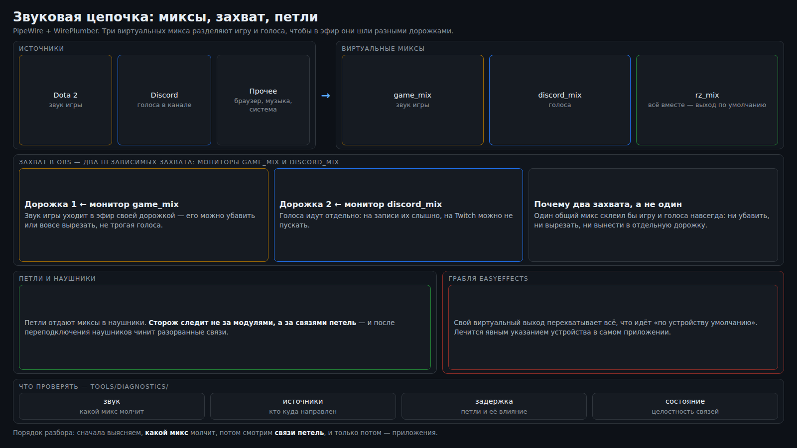

# Звук

Звук для эфира — это не «погромче сделать». Зрителю нужно услышать игру и ваши голоса, но не чужую
карту в фокусе, не браузер и не звук вашего же клиента дважды. Здесь три виртуальных микса и петли в
наушники, которыми управляет вкладка «Звук» в пульте, а держит их маленькая служба-сторож.



## Три микса

OBS **отказывается читать монитор того устройства, на которое сам выводит мониторинг** («По
умолчанию» = наушники): в логе это `Prevented feedback-loop in '<...>.monitor'`, а источник захвата
остаётся ни к чему не подключённым — в наушниках звук есть, а в миксе программы цифровая тишина.
Поэтому звук разводится виртуальными выходами:

```
игра        ──► game_mix   ──петля──► наушники ──► OBS «Звук системы»
голоса      ──► discord_mix ─петля──► наушники ──► OBS «Дискорд»
всё прочее  ──► rz_mix     ──петля──► наушники     (в эфир не идёт)
```

- **`game_mix`** — звук игры (потоки с `media.role=game`). Его монитор читает источник «Звук системы» —
  именно эту дорожку глушит фокус на чужой карте.
- **`discord_mix`** — голоса (поток WebRTC VoiceEngine / Discord). Его монитор читает источник
  «Дискорд», который **не глушится никогда**: иначе вместе с чужой игрой пропадали бы комментарии
  друзей.
- **`rz_mix`** — всё остальное (браузер и прочее) и **выход по умолчанию**. Его OBS не читает вовсе —
  именно поэтому удаётся читать мониторы двух других: устройство мониторинга «По умолчанию» больше не
  совпадает с наушниками, и блокировка снимается.

Каждый микс заводится петлёй в выбранное устройство (наушники). Петля создаётся с задержкой `30 мс` и
запретом переносить концы (`source_dont_move`, `sink_dont_move`), иначе PipeWire уводит их при
переподключении устройства.

Заготовки для PipeWire — в `deploy/pipewire/`:

- `10-mix-sinks.conf` — создание трёх виртуальных выходов при старте `pipewire-pulse` (после
  перезагрузки поднимаются сами);
- `20-app-routing.conf` — декларативные правила `node.rules`, которые сразу направляют поток в нужный
  микс (игра → `game_mix`, Discord → `discord_mix`, остальное — на выход по умолчанию).

Петли в этих файлах намеренно не описаны: их держит сторож — после переподключения наушников связь
петли рвётся, и восстанавливать её должен тот, кто умеет это видеть.

## Режимы «Стрим» и «Обычный»

Переключатель живёт в левой колонке пульта, под транспортом.

- **Обычный** — как обычная система: звук идёт прямо в выбранное устройство, миксов и петель нет,
  сторож выключен.
- **Стрим** — поднимаются три выхода, петли, `rz_mix` становится выходом по умолчанию, включается
  сторож, а захваты OBS наводятся на мониторы миксов.

Переключение идемпотентно: повторный тап по текущему режиму ничего не делает — **если режим здоров**.
Если сторож включён, но не работает, или петля играет не туда, повторный тап это починит: владелец жмёт
«Стрим» ровно тогда, когда что-то сломалось.

Порядок шагов. **Включение:** выбрать устройство → создать выходы → петли → `rz_mix` по умолчанию →
навести захваты OBS → `enable --now rz-mix.service` → записать состояние. **Выключение:** снять сторож
(`disable --now`) → вернуть выход по умолчанию → увести потоки из виртуальных выходов → выгрузить петли
и выходы → вернуть «Звук системы» на монитор устройства и удалить «Дискорд» → убрать состояние.

**Источник правды о режиме — состояние службы** (`is-enabled` / `is-active`), а не свой файл: сторож
могли поднять руками, и тогда режим уже «стрим». Режим вычисляется, а не хранится.

Если OBS выключен, системная часть переключения всё равно выполняется, а шаг с захватами пропускается —
в интерфейсе появляется подсказка «запустите OBS и нажмите «Стрим» ещё раз». При идущем эфире или
записи сервис сначала требует подтверждения: переключение рвёт звук в эфире.

## Выбор устройства и список проблем

Выбранное устройство хранится одной строкой в файле `rz_mix.device` (в каталоге модуля) и переживает
перезагрузку. Порядок выбора: выбранное → гарнитура по образцу имени → первый физический выход.
Виртуальные выходы и мониторы в выборе не участвуют.

**Одна и та же гарнитура видна под двумя именами** — по беспроводному донглу и по USB на зарядке, — это
разные устройства PipeWire. Поэтому в конфигурации зашит не точный адрес, а образец имени
(`Logitech_A20`), а явный выбор владельца важнее догадок по имени.

Пульт показывает `issues` — человеческие строки о том, что не так. Обязательно попадают: «петля играет
не в выбранное устройство», «петля играет сразу в два устройства», «режим стрима, но сторож не
работает», «в обычном режиме остались виртуальные выходы». Пустой список — всё в порядке.

## Почему сторож проверяет связи, а не модули

Петля `module-loopback` создаётся по имени устройства. Когда наушники отключаются и подключаются заново
(или перезапускается PipeWire), **модуль петли остаётся в списке с прежними аргументами** — но его выход
уже никуда не подключён: старое устройство уничтожено, а новый узел никто не связал. Снаружи схема
выглядит целой (модуль есть, поток есть, имя верное), а в наушниках тишина. Сторож, который проверяет
«модуль на месте», этого не видит и молчит.

Поэтому сторож каждый цикл смотрит **не модули, а связи портов** (через `pw-dump`: у связи —
`input-node-id`/`output-node-id`, у узла — `node.name`) и восстанавливает их. Починка — переподключение
портов (по `FL` и `FR`), а не пересоздание модуля: это дешевле и не рвёт звук.

Отдельный баг этого же класса — **«звук играет в двух местах»**: после возврата устройства петля
осталась подключённой и к наушникам, и к прежнему устройству-заглушке. Сторож, умеющий только
добавлять связь, старую не снимает; правильный сторож ещё и чистит связи петли с прочими физическими
выходами. `pactl move-sink-input` для потока петли бесполезен (`Invalid argument`) — только `pw-link`.

Служба `rz-mix.service` включается **вместе с режимом «Стрим»** и снимается вместе с «Обычным»: сторож,
стоящий в автозапуске постоянно, подхватывал бы звук после каждой перезагрузки, и владелец видел бы
«оно опять само включилось».

## Грабли EasyEffects

Программа с виртуальным выходом (**EasyEffects**: `easyeffects_sink`) забирает себе потоки, **у которых
устройство не задано явно**, — то есть всё, что идёт «по умолчанию». В эфире это выглядит как тишина на
дорожке приложения при живом звуке в наушниках.

Проверка одной командой: сыграть тон **без указания устройства** (обычное воспроизведение) и посмотреть,
куда он попал. Тон уехал в виртуальный выход — перехват подтверждён.

Лечение — **привязать приложение к своему устройству в настройках самого приложения** (например
Discord: «Устройство вывода» → нужный микс). Явно выбранное устройство чужая программа не перебивает:
именно так держатся игра (`game_mix`) и микрофонный тракт.

Что **не** работает (проверено):

- `pactl move-sink-input` на такой поток откатывается за пару секунд; сторож, перекидывающий поток по
  кругу, только делает захват рваным;
- правило WirePlumber не спасает: перехват происходит **после** создания потока;
- смена устройства в настройках самого EasyEffects перехват не прекращает, а пустое `outputDevice`
  вообще не даёт ему подняться. Файл правится только при остановленной программе и с бэкапом;
- виртуальные выходы (свои и чужие) нельзя выбирать устройством петли — звук уходит в никуда.

## Служебные мелочи

- Юниту звука обязательны `Environment=XDG_RUNTIME_DIR=%t` и
  `Environment=PULSE_SERVER=unix:%t/pulse/native`: без них `pactl` и `pw-dump` внутри службы не находят
  PipeWire, и вкладка «Звук» показывает пустой список устройств.
- Внешние команды читаются только в C-локали (`LC_ALL=C`, `LANG=C`): иначе `pactl` печатает поля на языке
  локали, разбор молча даёт пустой список, и вкладка «Звук» пишет «устройства не найдены». Провайдер
  ставит локаль в окружение каждого вызова сам.
- Петли читаются из аргументов модулей (`source=… sink=…`) — это заявленная цель; граф связей
  добавляется только чтобы поймать «прилипла к двум устройствам». `easyeffects_sink` в цепочке — не
  «второе устройство», а промежуточный узел обработки.
- Микс программы без слушателя измеряется записью: короткая запись, затем `volumedetect`. `−91 дБ` —
  цифровая тишина, `−30…−10 дБ` — живой звук.

Грабли и их лечение собраны в [`TROUBLESHOOTING.md`](TROUBLESHOOTING.md).
