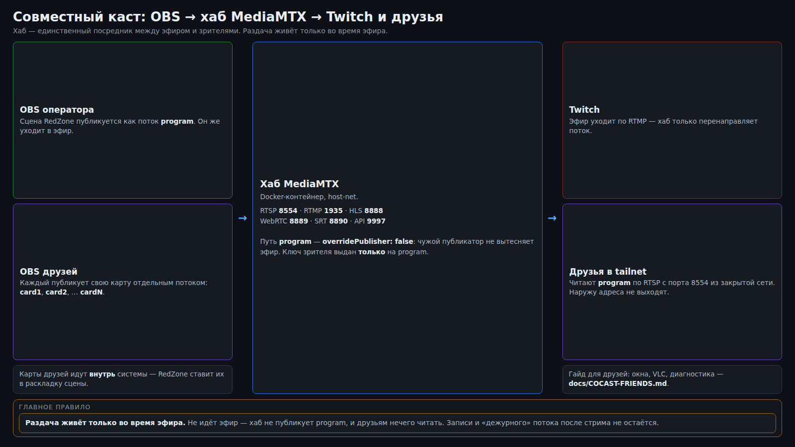

# Совместный каст

Соведущим нужна та же картинка, что видят зрители, и **с задержкой меньше секунды**. С самого Twitch
так не выйдет: там буфер в несколько секунд, и комментировать вместе по нему невозможно. Поэтому
картинку раздаёт ваш хаб MediaMTX, а в Twitch поток уходит отдельным релеем.



## Схема

```
OBS владельца ──RTMP──► хаб MediaMTX (путь program) ──► релей ──RTMP──► Twitch
                              │
                              └──RTSP──► друзья-соведущие (VLC)
```

- OBS публикует готовый микс в хаб на `rtmp://127.0.0.1:1935/program` (локальный публикатор
  авторизуется по IP, пароль не нужен).
- **Релей** читает `program` по RTSP и отдаёт поток в Twitch копией (`-c copy`): битрейт, качество и
  задержка те же, что были у OBS.
- Друзья читают `program` прямо из хаба — задержка доли секунды (замер по часам в кадре: меньше
  секунды).

Релей — **отдельная служба пользователя**, а не встроенный в хаб обработчик «сработать при появлении
потока». Встроенный обработчик срабатывает на **любую** публикацию в путь, включая тестовую, и тестовая
картинка ушла бы в прямой эфир. Отдельная служба запускается и гасится только переключателем.

## Переключение

Переключатель — подкоманда модуля (`python3 -m modules.redzone --help`, точные команды — в
`modules/redzone/README.md`); три действия: `on`, `off`, `status`.

- **`on`** сохраняет адрес и ключ Twitch в файл с правами `0600` (в логи и в чат ключ не печатается),
  переводит OBS на хаб и поднимает релей.
- **`off`** гасит релей и возвращает OBS на прямой Twitch из сохранённого.
- **`status`** показывает, идёт ли эфир, куда отдаёт OBS, работает ли релей и что в путях хаба.

При активном эфире `on`/`off` **отказываются работать без явного подтверждения**: переключение
прерывает трансляцию на 5–10 секунд (OBS перестаёт публиковать и начинает заново). В прямом эфире такие
вещи делаются осознанно.

Релей можно держать включённым постоянно: он молчит, пока нет ни адреса Twitch, ни потока в хабе. Если
машина перезагрузилась в режиме совместного каста, релей вернёт эфир сам, как только OBS снова начнёт
отдавать.

## Ключи и права

Доступ разграничивается в конфиге хаба (`authInternalUsers`). Принцип простой: **каждый может ровно то,
что ему нужно, и ни шагом больше.**

| Кто | Что может | Как |
|---|---|---|
| Локальный OBS | публиковать, читать, работать с API | без пароля, только с `127.0.0.1`/`::1` |
| Владелец (карты) | публиковать в карты | общий ключ публикации, путь только `~^card[0-9]+$` |
| Друг | публиковать в **свою** карту | персональный ключ, путь ровно `cardN` |
| Зритель-соведущий | читать **только** `program` | ключ зрителя, `action: read`, `path: program` |

- **В `program` снаружи публиковать нельзя вовсе** — этот путь уходит в прямой эфир, подмена картинки
  недопустима. Локальный OBS пишет туда по localhost.
- **Зритель карт не видит:** обращение к `cardN` с ключом зрителя даёт `401 Unauthorized`.
- **Второй публикатор карту не занимает:** у `pathDefaults` стоит `overridePublisher: false`. Иначе двое
  друзей на одной карте выкидывали бы друг друга по кругу (выглядело бы как «у обоих упало
  подключение»); теперь второй получает отказ, а работающий продолжает отдавать картинку.
- Ключи — только в рабочем `mediamtx.yml` (вне git); в репозитории лежит `mediamtx.example.yml` с
  заглушками.

## Публикация карт

Друзья публикуют в карты `card2`, `card3`, … — это их плитки в раскладке RedZone. Карта 1 — ваш
собственный клиент (захват игры), через хаб она не идёт. Формат ссылок и настройка OBS у друга —
в [`COCAST-FRIENDS.md`](COCAST-FRIENDS.md).

Хаб отдаёт список «кто сейчас шлёт» через API:

```bash
curl -s http://127.0.0.1:9997/v3/paths/list
```

Порты хаба: `8554` RTSP, `1935` RTMP, `8888` HLS, `8889` WebRTC, `8890` SRT, `9997` API. Пути: `program`
(общий эфир) и `card1..cardN` (карты).

## Друзья по tailnet

Хаб публикуется **только внутри tailnet**: друзья ставят Tailscale и получают доступ **к одному узлу**
(share node), к остальной сети владельца доступа у них нет. Наружу в интернет ничего не выставляется. В
домашней сети тот же хаб доступен по локальному адресу.

## Задержка и чтение

- Чтение общего эфира — **только по RTSP**. SRT-чтение из этого хаба падает (`incoming UMSG: 6 INVALID
  SIZE`); публикация по SRT при этом работает.
- Задержка складывается из буфера источника (около секунды) и сети; «ноль» недостижим.

## Проверка без эфира

У модуля есть самопроверка: она публикует тестовую картинку с часами, читает её так же, как будут
читать друзья, снимает кадр для замера задержки и прогоняет релей **в тестовый путь хаба**, ничего не
отправляя в Twitch. За полминуты различает «сломано у нас» и «сломано у друга», не рискуя показать
зрителям тестовую картинку.

> Пока релей поднят, `program` **нельзя** использовать для тестов: всё, что туда попадёт, уйдёт
> зрителям.

## Грабли

- **Правку `mediamtx.yml` не подхватывает повторный `up`** — у уже работающего контейнера конфиг
  читается только перезапуском. Делайте это вне эфира гостей: публикаторы отваливаются, но их OBS
  переподключается сам.
- **`program` — не тестовый путь** (см. выше).
- **Читать только RTSP** (см. выше).
- **SELinux**: монтирование конфига без флага `,z` выглядит как «configuration file not found» —
  контейнер просто не видит файл.
- **Секреты в выводе диагностики**: `ffprobe`/`ffmpeg` печатают URL целиком вместе с паролем. Резать
  вывод фильтром перед показом.

Грабли и их лечение — также в [`TROUBLESHOOTING.md`](TROUBLESHOOTING.md).
