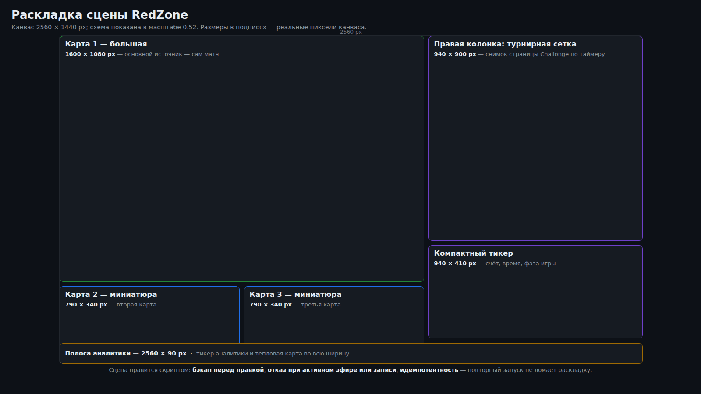

# RedZone — модуль мультитрансляции

RedZone показывает несколько карт Dota 2 одновременно, по образцу NFL RedZone: **одна большая карта в
фокусе, полоса миниатюр остальных, справа колонка чата**. Фокус переключается сценой, поэтому нет
перетаскивания элементов на лету — одна сцена на каждый вариант кадра.

Это модуль пульта (`modules/redzone/`), а не отдельная программа: раскладку он собирает в той же
коллекции сцен, которой управляет пульт, звук переключается из вкладки «Звук», а чат, сетка и каст —
его собственные службы. Устройство модулей — в [`MODULES.md`](MODULES.md).



## Раскладка сцены

```
┌────────────────────────────────────┬──────────────┐
│                                    │  миниатюра 2 │
│                                    ├──────────────┤
│           большая карта            │  миниатюра 3 │   RZ3 · N
│        (красная рамка = фокус)     ├──────────────┤
│                                    │     чат      │
├────────────────────────────────────┴──────────────┤
│  вебка  │  алерты  │        RED ZONE              │
└───────────────────────────────────────────────────┘
```

- Большая карта — `1984×1116`, миниатюра — `512×288` (в выходном 1080p это `384×216`).
- Колонка справа — миниатюры и высокий чат.
- Нижняя полоса — вебка (`462×260`) в рамке (`478×276`), блок под алерты и плашка «RED ZONE».
  Вебка и её рамка лежат **последними в списке слоёв**, иначе плашка их закрывает.
- Коллекция сцен — «Стрим», канва `2560×1440`.

Карты:

- **Карта 1 — свой клиент игры.** Источник «захват игры» (Vulkan-хук): картинка приходит, когда клиент
  запущен через обёртку захвата.
- **Карты 2–3 — поток из хаба.** Медиа-источник на `rtsp://127.0.0.1:8554/cardN` поверх заглушки
  «КАРТА N»; пока потока нет, видна заглушка, пошёл поток — сверху появляется картинка со звуком
  (`clear_on_media_end`). Задержка чтения ≈1 с; ради плавности у источника буфер `3 МБ` и софт-декод.

### Сцены и фокус

| Сцена | Что показывает |
|---|---|
| `RZ3 · 1 / 2 / 3` | мозаика: эта карта крупно, две другие миниатюрами, вебка, плашка, чат |
| `RZ · К1 / К2 / К3` | только эта карта на весь кадр, вебка в углу |

Фокус переключается сценой из пульта или хоткеями. Обычный цифровой блок OBS остаётся как был: сцены
«Dota 2», «Перерыв», «Чёрный экран» и прочие не тронуты. Сцены RedZone стоят в начале списка сцен, а в
планшете показываются в конце — без номеров numpad: номера это ручной маппинг, который при желании
дополняется отдельно.

## Локальный чат

Встроенный браузер OBS на целевой машине не грузит внешние сайты, поэтому готовые виджеты чата
показывали пустой кадр. Модуль делает чат сам: **релей читает чат канала и отдаёт страницу с
`127.0.0.1`**, а локальные страницы браузер OBS рисует нормально.

- Чтение — анонимное, только на чтение, по TLS; токены доступа не нужны.
- Страница чата отдаётся по `http://127.0.0.1:8097/` с **прозрачным фоном** (через браузерный источник
  в OBS) и получает сообщения потоком SSE (`/events`), с догоном последних сообщений при подключении.
- Эмодзи релей проксирует через себя и кеширует: до CDN картинок браузер OBS тоже не дотянется.
- `/health` показывает состояние соединения и «сколько секунд назад было последнее сообщение» — это
  различает «не подключено» и «подключено, но в чате тихо».
- Канал и порт задаются переменными `CHAT_CHANNEL` и `CHAT_PORT` (по умолчанию порт `8097`).

Служба — обычный `systemd --user` юнит с `Restart=always`: чат переживает перезагрузку и сам
переподключается.

## Турнирная сетка

Страница турнира показывается в эфире картинкой, а не браузерным источником: снимок делает headless
Chrome (который во внешнюю сеть ходит), а OBS показывает готовый PNG источником-картинкой.
Обновление — таймер раз в 5 минут. Адрес страницы задаётся переменной `BRACKET_URL`.

Грабля: обновлятор не должен при каждом прогоне заново задавать положение источника — иначе ручная
подвижка в OBS откатится через пять минут. Положение задаётся только при создании.

## Совместный каст

Соведущим нужна та же картинка, что в эфире, с задержкой меньше секунды: на самом Twitch задержка в
несколько секунд, комментировать вместе невозможно. Модуль раздаёт готовый эфир из хаба, а в Twitch
поток уходит отдельным релеем без перекодирования. Полностью — в [`COCAST.md`](COCAST.md), гайд для
друзей — в [`COCAST-FRIENDS.md`](COCAST-FRIENDS.md).

## Звук

Раздельный звук — сердце аккуратной мультитрансляции: фокус на чужой карте должен глушить только игру,
но **не** комментарии друзей из Discord. Поэтому звук разведён на три микса, а игра и голосовой чат
идут отдельными дорожками — игра через «Звук системы», голоса через «Дискорд». Глушение по сцене
делает небольшой скрипт: ушла карта в фокус — звучит её дорожка, ушла с RedZone на обычную сцену —
возвращается как было. Микрофон не трогается никогда.

Подробности маршрутизации и грабли — в [`AUDIO.md`](AUDIO.md).

## Что где лежит

Всё в `modules/redzone/`. Точные команды и состав файлов — в `modules/redzone/README.md`; список
подкоманд модуль печатает по `python3 -m modules.redzone --help`. Рабочие файлы (выбранное устройство,
сохранённый адрес эфира) лежат вне git и с правами `0600`; копии коллекции сцен перед правками —
в `modules/redzone/backup/`.

Грабли, в которые уже наступали, собраны в [`TROUBLESHOOTING.md`](TROUBLESHOOTING.md).
